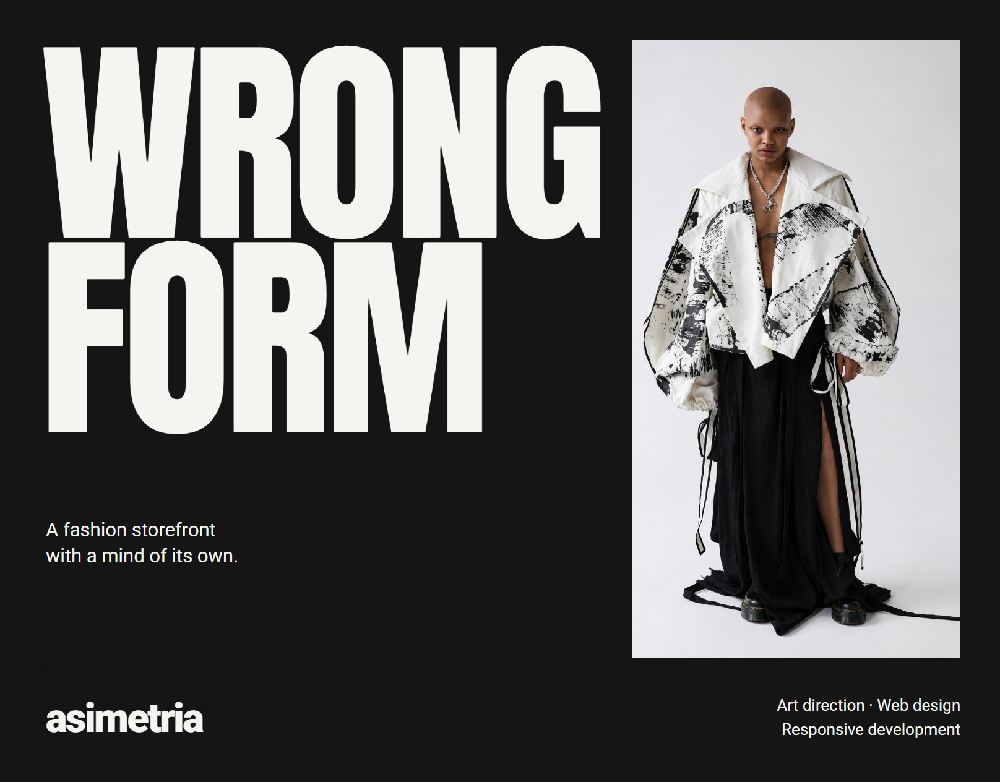

# Asimetria / WRONGFORM

A fashion storefront built around oversized typography, asymmetrical clothing and native-scroll motion. Designed and developed as an independent concept project.

**[Live website](https://wertyfff.github.io/asimetria/)** · **[Complete Behance case study](output/presentation/behance/ASIMETRIA-complete-case-study.jpg)** · **[Instagram screenshots](output/presentation/instagram/)**



## The work

- Art direction: black, paper and stone surfaces with a deliberately restrained visual identity.
- Typography: self-hosted Anton for the main wordmark and loading state, Roboto for the interface.
- Loading transition: matching letter positions and a smooth dark-to-light crossfade.
- Interaction: pointer-responsive lettering and a collection that moves from order to disruption and back during native scrolling.
- Photography: AI-assisted clarity enhancements, responsive image variants and complete garment silhouettes.
- Shopping interface: category filtering, product dialogs, size selection, a persistent local bag, USD prices and a Telegram order handoff.
- Mobile refinement: readable product information, larger touch targets, responsive dialogs, two-column product browsing and document flow on short screens.
- English localization, image descriptions, keyboard focus and reduced-motion layouts.

## Run locally

No build step or package installation is required. From the repository root:

```sh
python -m http.server 5173 --bind 127.0.0.1 --directory dist
```

Open `http://localhost:5173/`.

## Repository structure

| Path | Contents |
| --- | --- |
| `dist/` | Complete static website, self-hosted fonts and image assets |
| `output/presentation/behance/` | Cover, nine ordered case-study panels and a complete single-image case |
| `output/presentation/instagram/` | Five horizontal website screenshots, including smaller upload copies |
| `output/presentation/screens/` | Actual desktop and mobile browser captures used in the presentation |
| `output/presentation/case-study.html` | Editable English case-study layout |
| `output/presentation/cover.html` | Editable cover layout |

## Validation

Chromium layouts were checked at 320 × 568, 390 × 844, 430 × 932, 768 × 1024, 844 × 390 and desktop widths. A touch-enabled emulated mobile context was used to exercise filtering, missing-size validation, adding to the bag, totals and removal. Reduced-motion layouts and JavaScript syntax were checked. This does not claim testing on physical devices or Safari.

## Project status and credits

Products and prices demonstrate the interface. There is no payment processor, inventory service or fulfilment backend. Orders are handed off to the existing Telegram contact.

Photographs were supplied for the project and enhanced with AI-assisted processing. The boutique image is a visualization. Photography and garment designs belong to their respective creators; this repository does not grant rights to third-party imagery. Anton is distributed with its Open Font License in `dist/assets/fonts/anton-OFL.txt`.

Presentation materials are in English. See [the publishing notes](output/presentation/PUBLISHING.txt) for the Behance upload order and Instagram caption.
